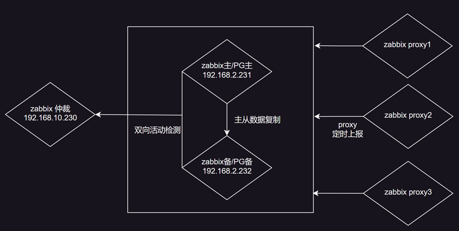
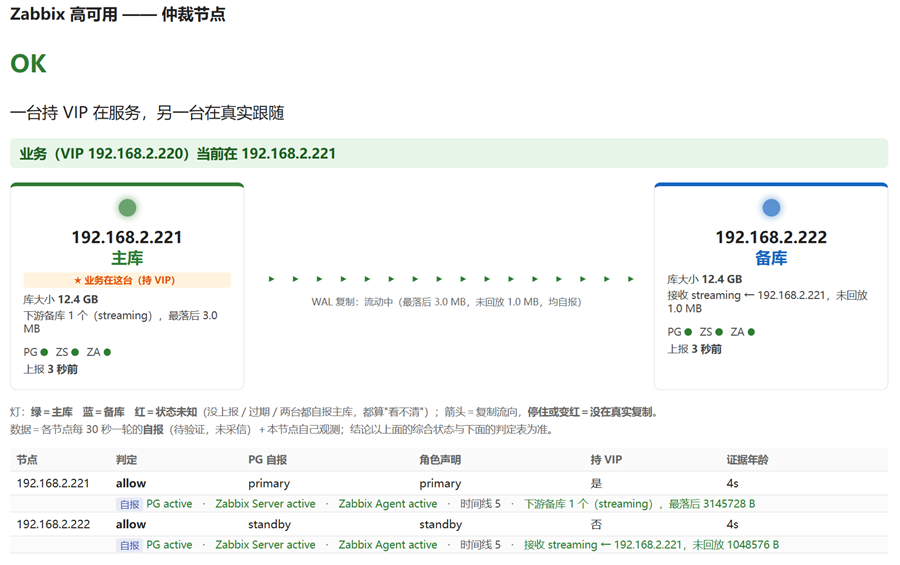
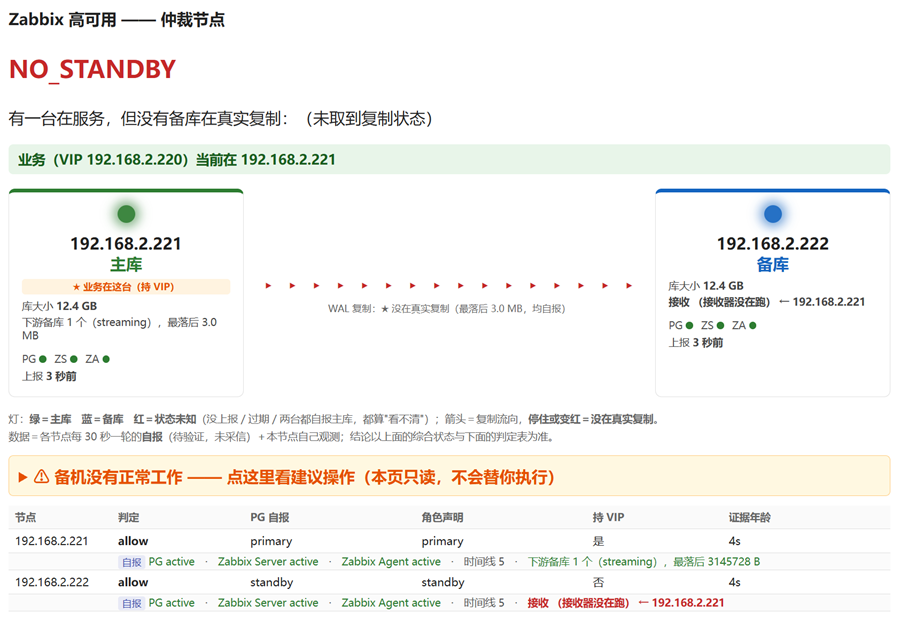

# 监控上千个对象场景中，Zabbix高可用架构设计

做运维的朋友们可能都有过这样的深夜惊魂：好容器完成了监控的Server、Proxy的部署、告警的收敛，监控的覆盖率也达标了，结果承载Zabbix Server和PostgreSQL的机器突然宕机。那一刻，不是“少看几张图”的问题，而是整个团队瞬间“告警失明”。监控对象越多，积累的数据量就越大，恢复就会越繁琐，这个时候，快速的恢复系统的可用是最为重要的任务，所以现在和大家分享一下我在设计这套系统时的取舍与思考。

------

### 第一部分：痛点与取舍——我们为什么要这么设计？

做高可用，本质上是一场“拿什么换什么”的交易。

我们要解决的问题非常明确：监控对象多，环境复杂。一旦主机故障，最要命的不是数据丢了，而是在最需要告警的时候，我们失去了全部告警能力。

基于这个需求，定下了三条硬约束：

1. **无单点故障**：无论是zabbix server还是数据库，都需要冗余的设计。

2. **复制是异步的**：数据是持续的写入的，异步传输虽然可能会损失一些数据（可以通过通过架构上的设计来避免）但是保证主server的写入性能，毕竟监控项数量起来了，采集的数据量写入也不小。

3. **底线是分钟级恢复**：我们可以接受丢失几分钟的数据，但绝对不能接受系统停摆几个小时。

认清了现实，我们确立了按优先级排序的三条取舍原则：

**第一优先级：绝不出双主 > 一切。** 数据分叉（双主）是不可逆的灾难，而停机是可恢复的。所以，在任何不确定的情况下，我们的答案都是“不动作”。

**第二优先级：可用性 > 零丢失。** 我们要的是“分钟级恢复+可控丢失”。为了快速拉起服务，我们愿意牺牲那一点点还没来得及同步的数据。

**第三优先级：好维护 > 聪明。** 我们拒绝引入Keepalived、etcd或Patroni这些复杂的组件。我们只需要一个状态命令和一张决策清单。归位要人跑、强制启动要人敲，越简单越不容易出错。

所以，这套方案解决的是“可用性”问题，而不是“数据保全”问题。我们要保管的不是数据（反正有主备两份），而是“能登录节点”的能力。

根据这些原则，总体架构图如下：

架构非常简单，就是两台配置一样的虚拟机作为盛昌服务器，另外拿一台配置略低的服务器当作仲裁机，生产机定期将自己的状态上报给到仲裁，再依据仲裁提供的信息决定自己当前的服务启停，当无法与生产服务器通信时，保持当前服务状态。当前大部分使用场景中，监控数量不超过五十万，NVPS大概也是在5000以内，实际NVPS我个人不是很看重，毕竟一条日志和一个整数的写入在NVPS的计算里面体现不出差异，但是对于系统资源的消耗是完全不一样的；另外采集数据经过zabbix proxy整理以后，到server通常都是顺序的写入了，对存储的压力并不大，反而要对历史数据进行分析的时候会产生大量的离散读，这个时候压力是最大的。所以大部分场景中把数据库和zabbix server和DB部署在同一个虚拟机里面是能够应付的，带来的好处对外是一个独立的环境，运维起来相对简单，在本方案中，实际有两套完整的监控系统，因为zabbix的前端基本就是静态的，所以只要保证后端数据库的数据库完整，前端就能正常操作。最后，因为数据库是完全复制，所以也方便做演练。

------

### 第二部分：不同场景的应对——出了事各自怎么办？

高可用架构不是装完就万事大吉，而是要看它在各种极端情况下的表现。我们把各种故障场景的“损失”和“收益”做了一个盘点：

| 故障场景             | 收益（做对了什么）                     | 损失（付出了什么代价）                             |
| -------------------- | -------------------------------------- | -------------------------------------------------- |
| 主库真故障           | 60秒内做出决策，约2分钟服务在VIP上恢复 | 少量数据丢失                                       |
| 主库计划内重启       | 数据零丢失                             | 维护窗口内若发生真故障，系统不会自动切换           |
| 备库故障             | 主库继续服务，业务不受影响             | 进入“一台服务、零台备份”的脆弱状态（可能静默数月） |
| 仲裁节点故障         | 主库继续服务不中断                     | 失去自动切换能力，需人工兜底                       |
| 网络分区             | 绝不发生双主                           | 该切的时候没切（服务不中断，但失去高可用）         |
| 旧主库修复回来       | 自动尝试归位一次                       | 故障期间未同步的写入永久丢失                       |
| 双主/撞车            | （无收益）                             | 正在发生数据分叉（最严重的灾难）                   |
| 复制早已中断后才故障 | 拒绝接管，防止丢失更多数据             | 服务停摆，直到人工介入                             |
| 两台同时重启         | 自动各归各位                           | 无损失                                             |

------

### 第三部分：灵活的仲裁设计——怎么防止“脑裂”？

为什么我们需要第三台仲裁机器？

想象一下，两台机器互相判断时，如果网络分区了，两边都看不到对方。这时候，两边都可能觉得自己才是对的，从而都去接管VIP，这就是可怕的“双主”。第三台仲裁节点的价值，就是“站在两边之外”。它能区分“两台都联系不上它”和“另一台真的死了”。

在我们的系统里，有两条雷打不动的不变式：

1. **我是主库 ⇔ 我持有VIP**：身份不是靠嘴说的，是靠绑上VIP这个动作来证明的。 2. **成为主库 = 本机自证 + 仲裁许可**：缺一不可。

仲裁许可的确切含义是：**VIP没有别人持有，且没有任何证据表明对端正在服务。**

一次自动接管，必须连过五道闸门：总开关打开 → 复制是刚刚断的（不是早就断了） → 仲裁可达且判定新鲜 → 判定结果为allow → VIP空闲且配置一致。

在这里，证据是有分级的：带外观测 > 网络观测 > 自报。我们能确证的只有两件事：**VIP在哪台、对端在不在复制**。该两项条件大于除此之外的一切读数。

在遇到网络分区或仲裁宕机时，系统会主动放弃自动化，宁可“该切不切”，也绝不双主。“什么都不做”也是一种极其重要的应对策略。

------

### 第四部分：极端情况下的恢复

当故障发生，旧主库修复后，为什么归位必须是两阶段的？

归位的意思是：让旧主库退回成备库，并重新接回复制。自动程序只做两件事：停掉本机的PG，然后尝试归位一次。为什么只试一次？因为每次归位都要停PG、回退数据目录，绝不能变成无限重试的死循环。拉起旧主库，必须让人来确认。

这里有一个强制启动（force）的设计。当仲裁坏了，但主库必须尽快起来时，人可以使用force命令。它省掉了繁琐的仪式，但**不降级判据**。它只解锁仲裁许可，不解锁VIP检查。一句话：**绕过仲裁，不绕过VIP**。

我们要时刻警惕最贵的错误——双主。数据分叉不可逆，而停机可恢复。所以我们在绑VIP前后各复查一次，值守程序也是第二道闸门。每一个不确定的地方，答案都是“不动作”。

------

### 第五部分：重建方式的考量

归位是有代价的，但也留了退路。

增量归位（pg_rewind）是分钟级的，如果失败，才会退到全量重建，那是小时级的。我们有一条铁律：**旧数据目录改名但不删**。脚本绝不替人删数据，这是最后一份“归位前”的现场证据。

为了配合这套架构，我们定下了三条核心纪律： 1. **不确定就不动作**：宁可该切不切（人工兜底），不可不该切却切了。 2. **能确证的只有两件事**：VIP在哪台、对端在不在复制；其余都是自述。 3. **恢复速度换少量数据**：用分钟级恢复+可控丢失，换来“绝不双主”的底线。

此外，没有任何东西可以直连节点真实IP的5432端口，所有流量必须走VIP。

------

**写在最后**

高可用架构从来不是追求100%不宕机，而是在灾难发生时，用最小的代价换取业务的延续。我们接受了分钟级的数据丢失，接受了偶尔的人工兜底，换来的极端条件下快速恢复的能力。运维的本质，就是在各种不确定性中，寻找那个最稳妥的平衡点。希望这次的分享，能给正在搭建高可用架构的你，带来一点不一样的启发。个人认知也有限，其中若有错误之处，也欢迎大家指正。

安装包下载地址：
链接: https://pan.baidu.com/s/1eekz1wk_HBpGl1qlMp4dgQ?pwd=gz5g 提取码: gz5g

集中运维系统DEMO：
http://www.whhonmon.cn:5006/#/welcome
机柜示意图：
http://www.whhonmon.cn:5006/#/DC_HQ_5F
网络TOPO图：
http://www.whhonmon.cn:5006/#/Network_all
动环数据图：
http://www.whhonmon.cn:5006/#/DC_env_all

作者微信：18602716300

